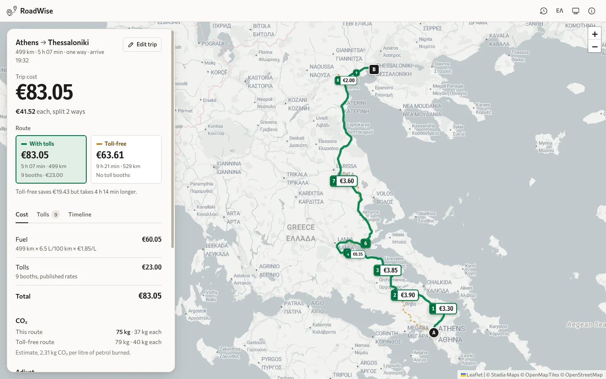
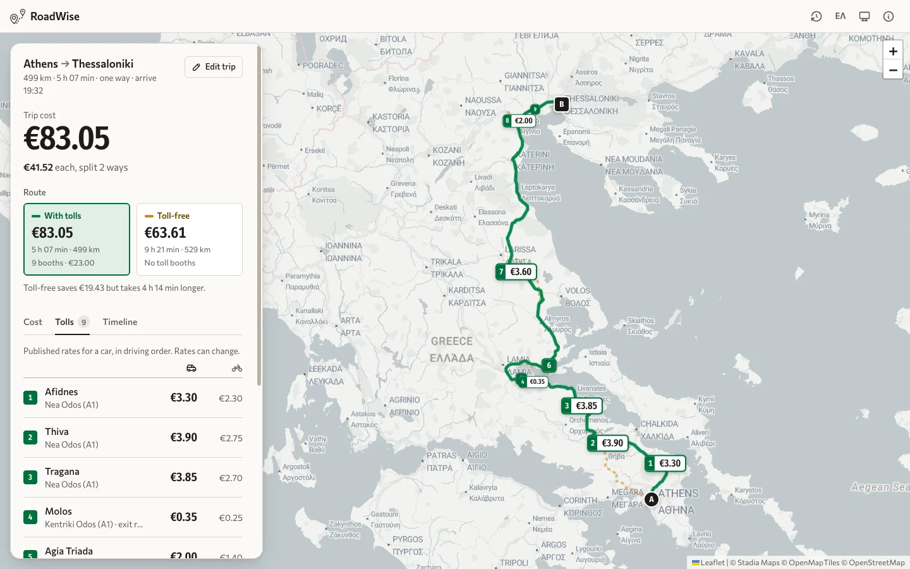
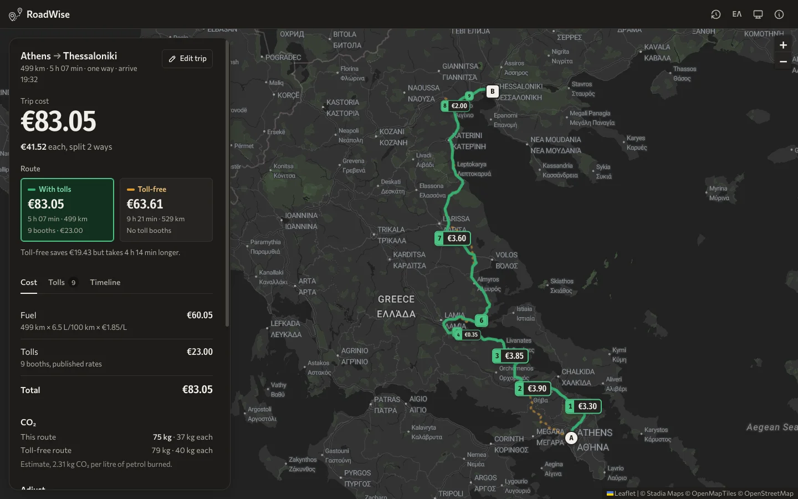
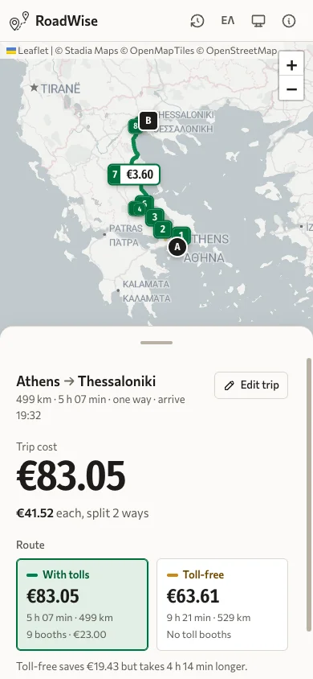
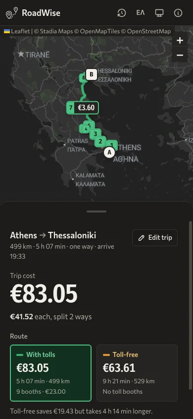

# RoadWise

Plan a drive on Greek motorways and see what it really costs: every toll booth on the route with its published price, plus fuel or charging, next to the toll-free alternative and the time it costs.



<table>
  <tr>
    <td width="50%"></td>
    <td width="50%"></td>
  </tr>
  <tr>
    <td align="center">Booth-by-booth tolls</td>
    <td align="center">Dark theme</td>
  </tr>
</table>

<p align="center">
  
  &nbsp;
  
</p>

## Features

- **Map-first layout.** The map fills the screen. One sheet holds planning and results: it floats on the left on desktop and becomes a draggable bottom sheet on phones.
- **Tolled vs toll-free.** Each search fetches both routes, so you can compare total cost, time and distance side by side and switch with one tap.
- **Booth-by-booth tolls.** Each toll booth on the route is shown on the map and in a list, with its name, motorway and price for your vehicle. Prices are published rates and can change.
- **Multi-stop trips.** Up to 6 points (start, stops, destination). Drag or use the keyboard to reorder them. You get distance and time per leg.
- **Fuel types and EV.** Petrol, diesel, LPG or electric (car and motorbike), each with default prices and consumption you can change. Shows CO₂ per trip and per person for both routes (an estimate).
- **Departure time and ETA.** Pick when you leave and see arrival times at each stop and toll booth, with optional breaks (15 min every 2 h of driving).
- **Cost split.** Total and per-person cost, one way or return. Copy the split or share a link.
- **Saved and recent trips.** The last 8 searches are kept on your device. Star a trip to keep it, and rename or delete trips.
- **Shareable links.** The URL holds the route and settings (`?wp=…`), so a link reopens the same trip. Older `?from=&to=` links still work.
- **English and Greek**, with locale-aware numbers, currency, distances and times.
- **Light and dark themes**, following the system or set by hand. Map tiles switch with the theme.
- **Accessible.** Works by keyboard, labels for screen readers, and respects `prefers-reduced-motion`.

Settings changes (vehicle, fuel, people, departure) recalculate locally and never trigger a new route request.

## Tech stack

- React 19 + Vite 7
- Tailwind CSS v4 (design tokens in `src/index.css`, see `DESIGN.md`)
- Leaflet with Stadia Maps tiles (Alidade Smooth / Smooth Dark)
- framer-motion for the sheet, view transitions and reordering
- OpenRouteService for geocoding and directions, via a Vercel serverless proxy (`api/ors/[...path].js`) that keeps the API key on the server
- Toll booth data in `src/data/tolls.json`

## Getting started

```sh
npm install
echo "ORS_API_KEY=your-openrouteservice-key" > .env
npm run dev
```

In development, Vite proxies `/api/ors` to OpenRouteService with the key from `.env`. In production, the Vercel function does the same using the `ORS_API_KEY` environment variable.

Map tiles work without a key on `localhost`. For a deployed domain, register it in a Stadia Maps account.

## Scripts

| Command | What it does |
|---|---|
| `npm run dev` | Start the dev server |
| `npm run build` | Production build into `dist/` |
| `npm run preview` | Serve the production build locally |
| `npm run lint` | ESLint |

## Project layout

```
api/ors/            Vercel proxy for OpenRouteService
src/components/     UI (MapView, Sheet, TripPlanner, ResultsView, Timeline, …)
src/hooks/          State (useTrip, useRoute, useSettings, useTripHistory, useTheme, …)
src/i18n/           English and Greek dictionaries, translator and formatters
src/utils/          Cost, route, timeline, toll matching and URL state helpers
src/data/           Toll booths and fuel defaults
scripts/            Maintenance scripts for the toll data
```
